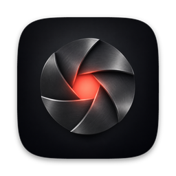
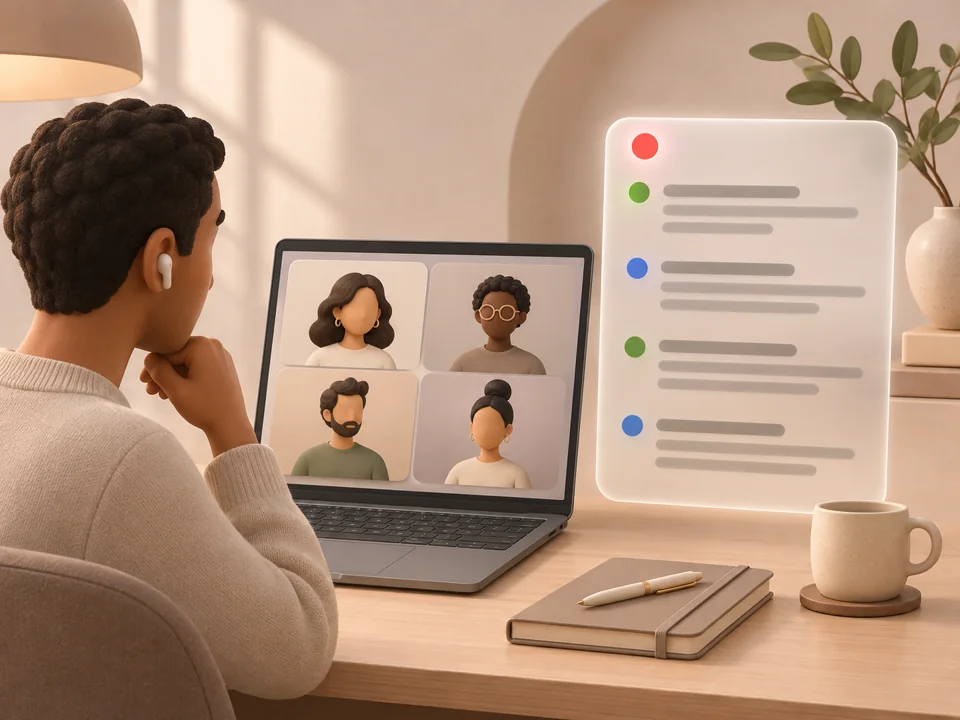
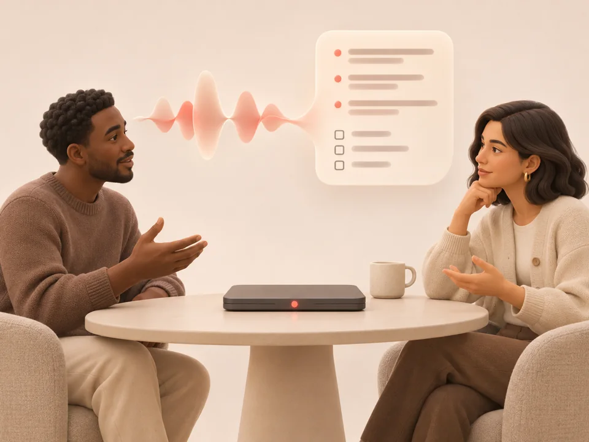
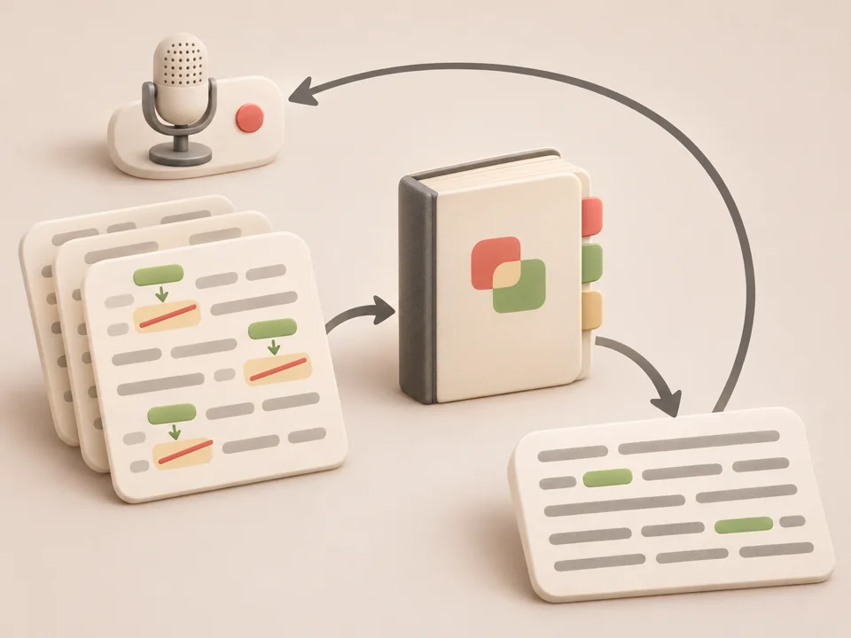
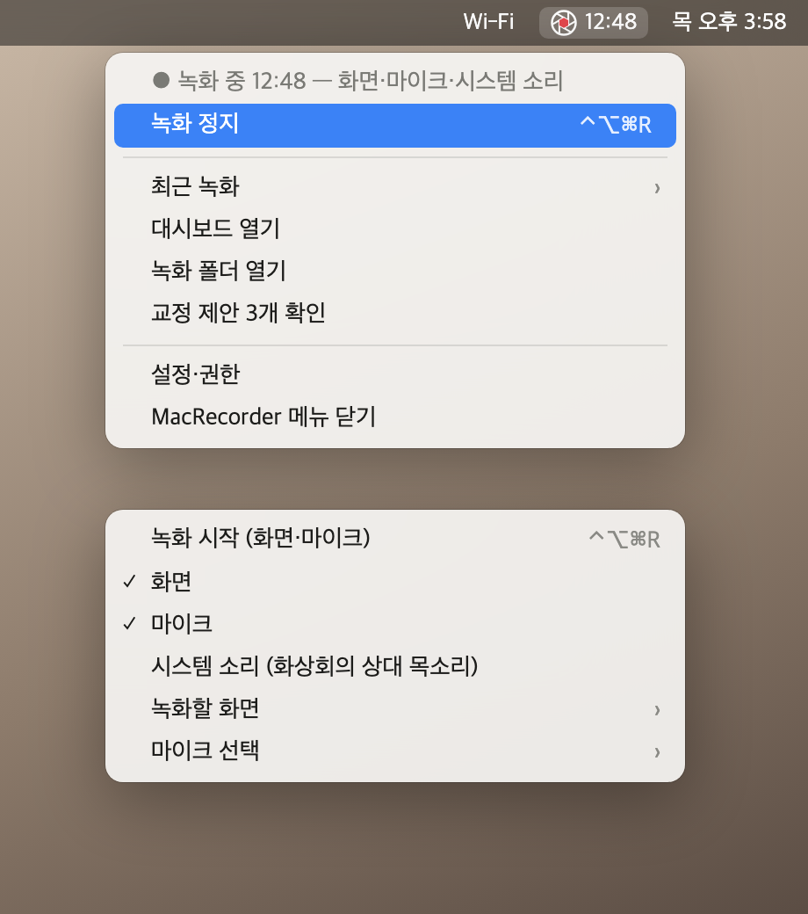
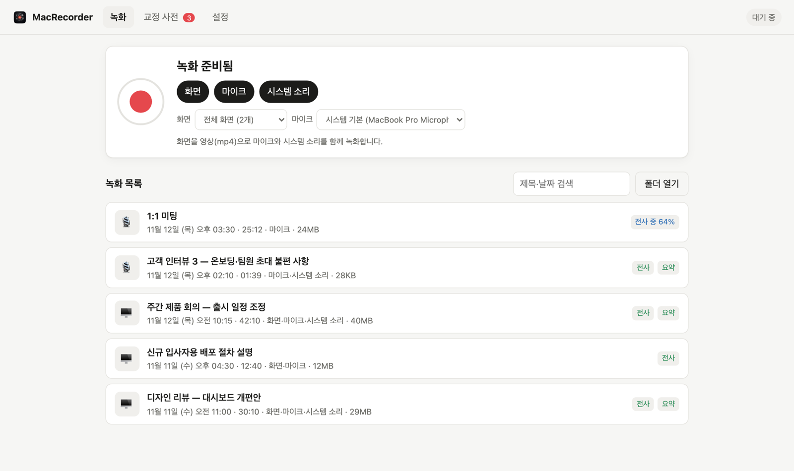
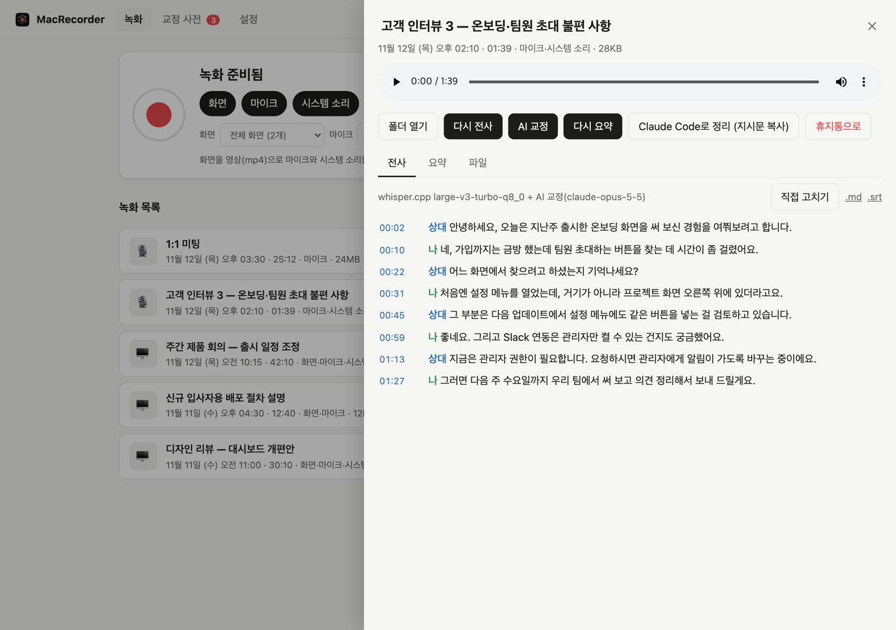
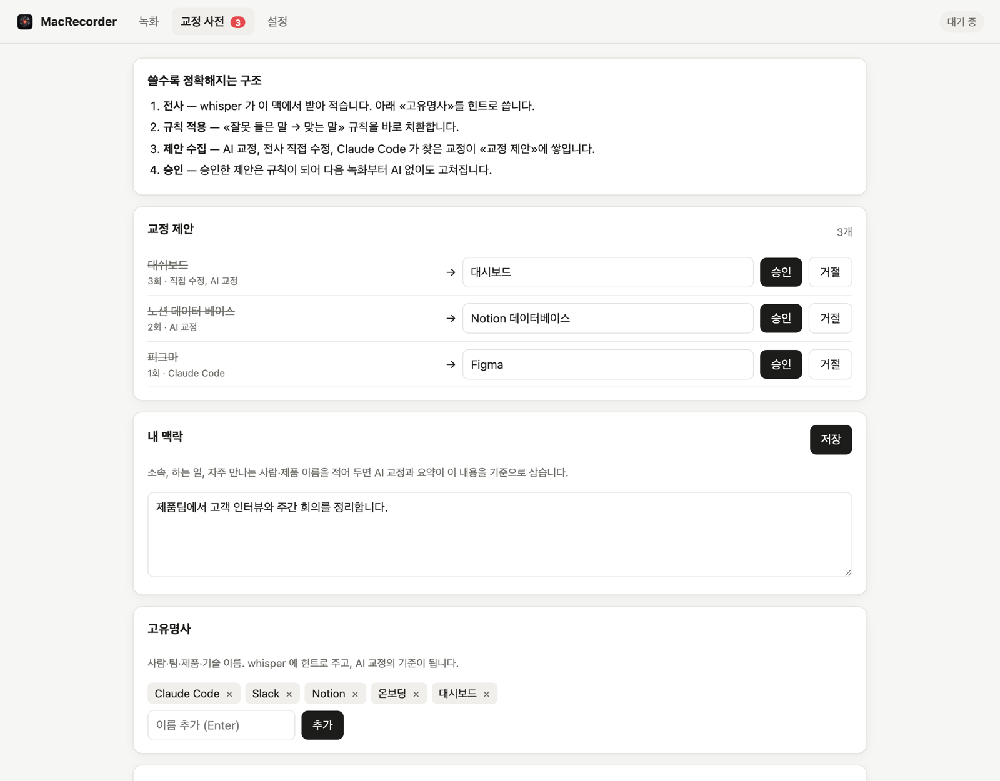

<p align="center"></p>

<h1 align="center">MacRecorder</h1>

<p align="center">맥에서 화면·마이크·시스템 소리를 녹화하고, 이 맥 안에서 전사한 뒤, 원하는 AI 로 요약하는 도구<br>
메뉴바 아이콘 · 웹 대시보드 · 단축키 ⌃⌥⌘R · <code>macrec</code> 명령 · Claude Code 스킬</p>


> **AI 에이전트(Claude Code 등)에게:** 사용자가 이 저장소 링크를 주며 설치를 부탁하면 [`docs/AGENT_INSTALL.md`](docs/AGENT_INSTALL.md) 의 절차를 처음부터 끝까지 따르세요.

## 설치

### Claude Code 에게 맡기기 (권장)

Claude Code 세션에 아래 한 줄을 붙여 넣으세요.

```
https://github.com/joonlab/mac-recorder 설치해 줘. 나도 바로 쓸 수 있게 해 줘.
```

Claude Code 가 필요한 도구 설치, 앱 빌드, 서버 등록, 권한 허용 안내, 시험 녹화까지 진행합니다. 중간에 세 가지(전사 기능 설치 여부, 요약에 쓸 AI, 기본으로 녹화할 소스)를 한 번에 물어봅니다.

### 직접 설치

```bash
git clone https://github.com/joonlab/mac-recorder.git ~/Developer/mac-recorder
~/Developer/mac-recorder/install.sh --all      # 녹화 + 로컬 전사 + Claude Code 스킬
macrec permissions --request                   # 권한 요청 창 → «MacRecorder Capture» 허용
macrec doctor                                  # 전부 ✅ 인지 확인
```

| 옵션 | 내용 |
|---|---|
| (없음) | 녹화, 메뉴바, 대시보드, `macrec` 명령 |
| `--with-transcribe` | 로컬 전사(whisper.cpp). 모델 약 0.9GB 를 내려받습니다 |
| `--with-claude-skill` | Claude Code 스킬 `mac-recorder` 설치 |
| `--all` | 위 두 가지 모두 |
| `--port 7931` · `--recordings <폴더>` | 대시보드 포트 · 녹화 저장 폴더 |

**필요한 것:** macOS 15 이상(Apple Silicon·Intel), [Homebrew](https://brew.sh). node·ffmpeg·pm2 는 설치 스크립트가 없으면 설치합니다. 앱은 이 맥에서 직접 빌드합니다(Xcode Command Line Tools 가 없으면 미리 빌드된 앱을 내려받습니다).

> 저장소를 `~/Desktop`·`~/Documents`·`~/Downloads` 안에 두지 마세요. 이 세 폴더는 macOS 가 접근을 따로 제한하는 폴더라 백그라운드 서버가 멈출 수 있습니다. 그래서 설치 스크립트는 이 위치에 설치하지 않습니다.

## 어디에 쓰나

| 장면 | 쓰임 |
|---|---|
|  | **화상회의 기록** — 화면·내 목소리(마이크)·상대 목소리(시스템 소리)를 함께 녹화합니다. 끝나면 자동으로 전사하고, «나·상대 구분»을 켜면 누가 말했는지 나눠 적습니다. |
|  | **화면 설명 녹화** — 업무 절차나 데모를 말로 설명하며 녹화해 동료에게 공유합니다. 모니터가 여러 대면 화면마다 따로 저장하고, 나란히 붙인 합본도 만듭니다. |
| 🪟 🌐 | **창·브라우저 탭만 녹화** — 웨비나·온라인 교육처럼 창 하나, 탭 하나만 담고 싶을 때. 여러 창·탭을 동시에 따로 녹화합니다. 녹화 중 메신저·메일을 봐도 들어가지 않습니다. 아래 «창·탭 따로 녹화». |
|  | **대면 회의·인터뷰 녹음** — 화면 없이 소리만(m4a) 녹음합니다. 전사 후 요약·결정 사항·할 일을 정리합니다. |
|  | **교정 사전으로 이름 표기 바로잡기** — 잘못 들은 사람·제품 이름을 고치면 «교정 사전»에 쌓이고, 다음 녹화부터 자동으로 고쳐집니다. |

## 쓰는 법

### 메뉴바



화면 오른쪽 위 조리개 아이콘을 누르면 녹화 시작·정지, 녹화할 소스(화면·마이크·시스템 소리), 화면·마이크 선택, 최근 녹화, 대시보드 열기가 있습니다. 녹화 중에는 아이콘 가운데가 빨갛게 바뀌고 경과 시간이 표시됩니다.

**단축키** — 어느 앱에서든 쓸 수 있습니다.
- **⌃⌥⌘R**(Control+Option+Command+R): 녹화 시작·정지
- **⌃⌥⌘P**: 일시정지·다시 녹화

**일시정지**: 쉬는 시간이나 개인 메시지를 볼 때 누르면, 다시 녹화할 때까지 화면·소리를 전혀 수집하지 않습니다(macOS 화면 녹화 표시도 꺼집니다). 다시 녹화하면 같은 파일에 이어 쓰고, 멈춘 시간은 파일에서 빠집니다. 녹화를 여러 개로 나눴다가 합칠 필요가 없습니다. 녹화 상세의 «녹화 중 기록»에서 어디서 멈췄는지 볼 수 있습니다.

**마이크 고르기**: 메뉴바 «마이크 선택»이나 대시보드의 «마이크» 칸에서 고릅니다. 목록에 `내장`·`블루투스`·`USB`·`가상 장치`가 붙어 노트북 마이크, 블루투스 이어폰 마이크, Zoom·Teams 가상 장치를 구분할 수 있습니다. 고른 마이크가 녹화를 시작할 때 연결돼 있지 않으면(이어폰을 껐을 때 등) 시스템 기본 마이크로 녹음하고 녹화 기록에 남깁니다. 블루투스 이어폰 마이크를 쓰는 동안에는 이어폰으로 듣는 소리 음질이 통화 수준으로 낮아집니다(macOS 블루투스 특성).

### 창·탭 따로 녹화

모니터 전체 대신 창 하나나 브라우저 탭 하나만 녹화합니다. 여러 개를 동시에 녹화할 수 있고, 하나하나가 녹화 목록에 따로 들어가 전사·요약도 따로 됩니다. 주 녹화(화면 전체)와 함께 돌려도 됩니다.

| | 창 녹화 | 탭 녹화(크롬 확장) |
|---|---|---|
| 시작 | 대시보드 «창·탭 따로 녹화 → 창 고르기»(여러 개 체크), 메뉴바 «창 하나만 녹화», `macrec start --window <ID>` | 녹화할 탭에서 확장 아이콘 → «이 탭 녹화» |
| 대상 | 아무 앱의 창(Safari 포함) | Chrome·Edge·Brave·Arc 탭 |
| 화면 | 그 창만. 다른 창에 가려져도 그 창 내용이 녹화됩니다. 최소화한 동안은 마지막 장면이 남고, 되살리면 이어집니다 | 그 탭만. 다른 탭을 보고 있어도 계속 녹화됩니다 |
| 소리 | 일반 앱은 그 앱 소리만. 브라우저 창은 맥 전체 소리(아래 참고) | 그 탭 소리만(+마이크 선택) |
| 끝남 | 정지를 누르거나 창을 닫을 때 | 정지를 누르거나 탭을 닫을 때 |
| 권한 | 녹화 엔진의 화면 기록 권한 | 브라우저 마이크 권한(마이크를 쓸 때만) |

- 브라우저는 소리를 별도 보조 프로세스(Helper)가 내서, macOS 가 창·앱 단위로 소리를 나눠 주지 않습니다(실측). 그래서 브라우저 창을 «창 녹화»하면 맥 전체 소리로 녹음합니다. 탭 소리만 담으려면 탭 녹화를 쓰세요.
- 진행 중인 창·탭 녹화는 대시보드 «창·탭 따로 녹화» 카드와 메뉴바에 나오고, 거기서 하나씩 일시정지·정지합니다. 탭 녹화의 일시정지·정지는 5초 안에 확장에 전달됩니다.
- 잠자기·화면 잠금 때 창 녹화도 자동으로 일시정지합니다.
- 크롬 확장 설치: [`docs/EXTENSION.md`](docs/EXTENSION.md). `macrec extension` 이 확장 폴더를 열고 설치 순서를 보여 줍니다.

```bash
macrec windows 교육            # 창 목록(ID·앱·제목), «교육»이 들어간 것만
macrec start --window 12345,12399 --mic   # 창 두 개를 동시에, 각각 따로
macrec live                    # 진행 중인 창·탭 녹화
macrec pause <녹화ID>           # 하나만 일시정지 (resume 으로 이어서)
macrec stop all                # 창·탭 녹화 모두 정지
```

### 대시보드 (http://127.0.0.1:7931)



| 탭 | 하는 일 |
|---|---|
| 녹화 | 녹화 시작·정지, 창·탭 따로 녹화, 녹화 목록, 재생, 전사(시각을 누르면 그 위치로 이동), 요약, 파일 내려받기, 휴지통으로 옮기기 |
| 교정 사전 | 내 맥락, 고유명사, 교정 규칙, 교정 제안 승인·거절 |
| 설정 | 권한 상태, 녹화 화질, 전사 언어·자동 전사, 요약·교정 AI 와 API 키, 요약 형식 편집, 녹화 폴더 바꾸기, 녹화 폴더 이름 규칙 |



### 명령줄 `macrec`

```bash
macrec start                  # 기본 소스로 녹화 시작
macrec start --audio-only     # 소리만
macrec start --system         # 시스템 소리(화상회의 상대 목소리) 포함
macrec pause                  # 일시정지 (macrec resume 으로 이어서 녹화)
macrec stop
macrec list                   # 최근 녹화
macrec show latest            # 가장 최근 녹화의 파일 경로
macrec transcribe latest --summarize
macrec glossary rule "클로드 코드" "Claude Code"
macrec doctor                 # 설치·권한·서버 점검
```

### Claude Code

`--with-claude-skill` 로 설치하면 Claude Code 에서 이렇게 말할 수 있습니다.

- «방금 회의 녹화 요약해 줘»
- «오늘 녹화에서 내가 맡은 할 일만 뽑아 줘»
- «지난주 녹화 중에 예산 이야기한 부분 찾아 줘»
- «전사에서 잘못 들은 이름 찾아서 교정 사전에 올려 줘»

대시보드의 녹화 상세에서 **«Claude Code로 정리 (지시문 복사)»** 를 누르면 그 녹화의 경로가 들어간 지시문이 복사됩니다. 지금 쓰고 있는 Claude Code 세션에 붙여 넣으면 됩니다. API 키는 필요 없습니다.

### Raycast (선택)

Raycast 를 쓰고 있다면 Raycast 설정 → Extensions → Script Commands → **Add Directories** 에서 설치 위치(`macrec version` 으로 확인)의 `raycast/` 폴더를 추가하세요. «녹화 시작/정지», «녹화 일시정지/다시 녹화», «녹음 시작 (소리만)», «녹화 상태», «녹화 대시보드 열기», «녹화 폴더 열기» 명령이 생깁니다.

## 전사·교정·요약

```
녹화 종료
  └─ 재생용 파일 만들기 (마이크와 시스템 소리 합치기, 여러 화면 합본)
  └─ 전사 (whisper.cpp, 이 맥에서)            ← 교정 사전의 고유명사를 힌트로 사용
       └─ 교정 규칙 치환 («잘못 들은 말 → 맞는 말»)
       └─ AI 교정 (선택)                        → 고친 단어는 «교정 제안»으로
       └─ AI 요약 (선택)                        → summary.md, 첫 줄이 녹화 제목
```

### 교정 사전에 항목이 추가되는 방식

1. 대시보드에서 전사를 **직접 고치고 저장**하면, 바뀐 단어가 «교정 제안»에 올라갑니다.
2. AI 교정이 고친 단어, Claude Code 가 찾은 단어도 같은 곳에 올라갑니다.
3. «교정 사전» 탭에서 **승인**하면 교정 규칙이 되고, 다음 녹화부터는 AI 없이도 전사 직후 바로 고쳐집니다. 거절한 제안은 다시 올라오지 않습니다.
4. «내 맥락»에 소속·자주 나오는 이름을 적어 두면 AI 교정과 요약이 그 내용을 기준으로 삼습니다.



### 요약에 쓸 AI

| 선택 | 필요한 것 | 비고 |
|---|---|---|
| 사용 안 함 | — | 전사까지만 |
| 내 Claude Code 세션에서 | Claude Code | 대시보드 버튼으로 지시문 복사 → 세션에 붙여 넣기 |
| Claude Code 자동 실행 | Claude Code 로그인 | 서버가 `claude -p` 로 실행, 본인 구독 사용 |
| OpenAI API | API 키 | 기본 모델 `gpt-5.5` (설정에서 변경) |
| Anthropic API | API 키 | 기본 모델 `claude-opus-5-5` (설정에서 변경) |

API 키는 대시보드 설정 화면에서 넣으며 `~/.mac-recorder/secrets.json`(권한 600)에만 저장됩니다. 환경변수 `OPENAI_API_KEY`·`ANTHROPIC_API_KEY` 가 있으면 그것을 씁니다.

## 개인정보

- **녹화 파일(영상·소리)은 이 맥 밖으로 나가지 않습니다.** 전사도 이 맥에서 합니다.
- AI 교정·요약을 켰을 때만 **전사 글**이 고른 AI(OpenAI·Anthropic·Claude Code)로 갑니다. 회사 정보가 담긴 녹화는 회사의 AI 사용 기준을 먼저 확인하세요.
- 대시보드 서버는 `127.0.0.1` 에만 열려 같은 Wi-Fi 의 다른 기기가 접근할 수 없습니다. 다른 웹사이트가 이 서버를 몰래 조작하지 못하도록 Host 헤더 검사와 JSON 요청 제한을 둡니다.
- 녹화를 지우면 macOS 휴지통으로 옮겨집니다(되돌릴 수 있음).

## 파일 위치

| 무엇 | 어디 |
|---|---|
| 녹화 | `~/Movies/MacRecorder/<날짜_시간_제목>/` (예: `20261118_1402_OO교육`, 0.3.1 이전 녹화는 `<YYYYMMDD-HHMMSS>`) |
| 녹화 폴더 안 | `recording.mp4`(또는 `.m4a`) 원본 · `recording_mixed.*` 재생용 · `display-<ID>.mp4` 추가 화면 · `recording_all.mp4` 화면 합본 · `transcript.md/.txt/.srt/.json` · `summary.md` · `session.json` |
| 설정·사전·키 | `~/.mac-recorder/` (`config.json`, `glossary.json`, `proposals.json`, `secrets.json`, `prompts/`) |
| 앱 | `~/Applications/MacRecorder.app`(메뉴바) · `~/Applications/MacRecorder Capture.app`(녹화 엔진) |
| 서버 로그 | `~/.mac-recorder/logs/server.log` |

**녹화 폴더 바꾸기**: 대시보드 설정 → «저장 위치·접속»에서 경로를 적거나 «Finder 에서 고르기»로 고른 뒤 «바꾸기». 지금 폴더의 녹화를 새 폴더로 옮길지 묻습니다(옮기지 않으면 기존 녹화는 대시보드 목록에서 보이지 않고 원래 폴더에 남습니다). 바탕화면·문서·다운로드(macOS 보호 폴더)나 iCloud·OneDrive 같은 동기화 폴더를 고르면 주의를 띄웁니다. 녹화 중에는 바꿀 수 없습니다.

**녹화 폴더 이름 규칙**: 설정 → «녹화 폴더 이름 규칙». 기본 `{date}_{time}_{title}` → `20261118_1402_OO교육`. 토큰은 `{date}` `{time}` `{hms}` `{title}` `{kind}`(화면·창·탭) `{sources}` `{app}`. 값이 빈 토큰은 앞뒤 구분자와 함께 빠집니다. 제목을 나중에 고치거나 AI 요약이 제목을 정하면 처리가 끝난 뒤 폴더 이름도 바뀝니다. «기존 녹화에도 적용»으로 예전 녹화 폴더 이름도 한 번에 바꿉니다. 폴더 안 파일 이름(`recording.mp4` 등)은 그대로 두고, 대시보드에서 내려받을 때 `20261118_1402_OO교육.mp4`·`…_전사.md`처럼 폴더 이름을 붙입니다.

녹화 원본은 트랙을 나눠 저장합니다(시스템 소리 트랙, 마이크 트랙). 전사할 때 나·상대를 구분하기 위해서입니다. 일반 플레이어는 첫 트랙만 재생하므로 두 소리를 합친 `_mixed` 파일을 함께 만듭니다.

## 업데이트·제거

**업데이트**: Claude Code 세션에 아래 한 줄을 붙여 넣으세요. 설치 위치를 찾아 최신 버전을 받고, 처음 설치할 때와 같은 옵션(전사·스킬 등)으로 다시 설치합니다. 권한을 다시 켜야 하면 안내합니다.

```
https://github.com/joonlab/mac-recorder 최신 버전으로 업데이트해 줘.
```

터미널에서 직접 하려면 `macrec update` 입니다(0.2.0 부터). 바뀐 내용은 [`CHANGELOG.md`](CHANGELOG.md) 에 있습니다.

**제거**: `macrec version` 으로 설치 위치를 확인한 뒤 그 폴더의 `uninstall.sh` 를 실행합니다. 녹화와 설정은 남깁니다.

녹화 엔진(`MacRecorder Capture`)이 바뀐 업데이트에서는 화면 기록·마이크 권한을 한 번 더 허용해야 합니다. 설치 스크립트가 예전 권한 기록을 정리하고 안내합니다. 메뉴바·서버만 바뀐 업데이트는 권한을 다시 묻지 않습니다.

## 모니터 연결·분리, 잠자기, 재부팅

녹화 중에 모니터를 빼거나 꽂아도 녹화는 끊기지 않습니다.

| 상황 | 동작 |
|---|---|
| «전체 화면» 녹화 중 외장 모니터를 뺌 | 소리는 내장 화면 녹화에 실려 있어 그대로 이어집니다. 합본에서는 그 화면이 빠지고 남은 화면만 보이며, 다시 꽂으면 같은 파일에 이어서 녹화하고 합본에도 다시 나옵니다 |
| 외장 모니터 하나만 녹화하다가 뺌 | 남은 화면(내장 화면)으로 옮겨 같은 파일에 계속 녹화하고, 다시 꽂으면 외장 모니터로 돌아갑니다 |
| 녹화 도중 모니터를 새로 꽂음 | «전체 화면» 녹화라면 그 모니터도 녹화에 더합니다(`display-<ID>.mp4`) |
| 같은 모니터를 다른 포트로 다시 꽂음 | 화면 ID 가 바뀌어도 제조사·모델·일련번호로 같은 모니터를 알아봅니다 |

- 어떤 변화가 있었는지는 대시보드 녹화 상세의 «녹화 중 화면 변화»와 목록의 «화면 변화 N» 표시로 볼 수 있습니다. 녹화 중에는 메뉴바에도 표시됩니다.
- 여러 화면 합본(`recording_all.mp4`)은 실제 모니터 배치(왼쪽→오른쪽) 순서로 붙이되, **그 순간 연결돼 있던 화면만** 넣습니다. 합본 화면의 비율은 주 화면 하나의 비율이라, 화면이 하나만 남은 구간은 화면을 꽉 채우고 여러 개인 구간은 나란히 맞춰 들어갑니다. 다시 꽂거나 새로 꽂으면 그때부터 함께 나옵니다.
- 화면별 개별 파일(`display-<ID>.mp4`)은 빠진 구간이 검정입니다.
- 화면을 옮기는 순간 소리가 0.3초 정도 비고, 전사할 때 이 구간은 무음으로 채워 이후 시각([MM:SS])이 어긋나지 않습니다.
- **잠자기·화면 잠금 → 자동 일시정지**: 녹화 중에 덮개를 닫거나 맥이 잠들거나 화면이 잠기면 그 순간 일시정지합니다(잠금 화면이 녹화되지 않습니다). 깨어나도 저절로 이어서 녹화하지 않고, 메뉴바나 대시보드에서 «다시 녹화»를 눌러야 같은 파일에 이어집니다. 메뉴바·대시보드에 «잠자기로 자동 일시정지됨»이 표시됩니다.
- 대시보드의 화면 목록은 모니터를 꽂거나 빼면 새로고침 없이 바로 바뀝니다(메뉴바 앱이 화면 변경을 알려 줍니다. 메뉴바 앱을 끈 경우 10초 안에 반영).
- 서버는 pm2 가 관리합니다. 서버가 꺼지면 pm2 가 다시 켜고, 로그인할 때도 자동으로 다시 실행됩니다(`pm2 resurrect` 를 실행하는 LaunchAgent).
- 메뉴바 앱도 로그인할 때 자동 실행됩니다.

## 문제 해결

[`docs/TROUBLESHOOTING.md`](docs/TROUBLESHOOTING.md) — 권한을 켰는데 녹화가 안 될 때, 메뉴바 아이콘이 «서버에 연결할 수 없음»일 때, 마이크 소리가 작을 때 등.

## 구조

```
메뉴바 앱 ─┐
대시보드  ─┼─ HTTP ─▶ 서버(node, pm2, 127.0.0.1:7931) ─ open -n ─▶ MacRecorder Capture.app
macrec    ─┤                     │                                   (ScreenCaptureKit 로 화면·소리 녹화)
Raycast   ─┘                     └─ 백그라운드 작업: 재생용 파일 · whisper 전사 · AI 교정·요약
```

녹화 엔진을 서버가 직접 실행하지 않고 `open -n` 으로 띄우는 이유: macOS 는 화면 기록 권한을 «실행한 쪽»에 묻습니다. 직접 실행하면 node 에 권한을 줘야 하지만, `open` 으로 띄우면 녹화 엔진 앱 하나에만 주면 됩니다.

| 폴더 | 내용 |
|---|---|
| `native/capture` | 녹화 엔진(Swift, ScreenCaptureKit) |
| `native/menubar` | 메뉴바 앱(SwiftUI) |
| `server` | API 서버·전사·교정·요약·백그라운드 작업 |
| `public` | 대시보드 |
| `bin/macrec` | 명령줄 도구 |
| `claude/skills` | Claude Code 스킬 |
| `raycast` | Raycast 스크립트 명령 |
| `templates` | 요약·교정 프롬프트, 예시 사전 |

개발: `npm test` · 앱 빌드 `native/build.sh` · 서버만 실행 `node server/index.mjs` · 모니터 꽂기·빼기 시험 `test/hotplug/run.sh`(가상 모니터 사용). 변경 기록은 [`CHANGELOG.md`](CHANGELOG.md).

## 라이선스

MIT
